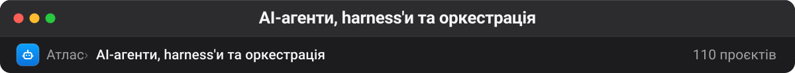

# AI-агенти, harness'и та оркестрація

Ядро колекції й причина, чому вона взагалі така велика. Агентні фреймворки, harness'и навколо Claude Code / Codex / OpenClaw, дашборди для керування роями агентів, MCP-сервери. Категорія навмисно широка: у 2025–2026 межа між «фреймворком», «оболонкою» і «продуктом» розмита, і розділяти їх штучно означало б щотижня перекладати репозиторії з полиці на полицю.

| Проєкт | Оригінал | ★ | Мова | Що це |
| --- | --- | --: | --- | --- |
| [openclaw/openclaw](https://github.com/openclaw/openclaw) 🔗 | — | 393 800 | TypeScript | The AI that really does things. Any OS. Any Platform. The lobster way. 🦞 |
| [NousResearch/hermes-agent](https://github.com/NousResearch/hermes-agent) 🔗 | — | 260 051 | Python | The agent that grows with you |
| [n8n-io/n8n](https://github.com/n8n-io/n8n) 🔗 | — | 209 431 | TypeScript | Fair-code workflow automation platform with native AI capabilities. Combine visual building with custom code, self-host or cloud, 400+ integrations. |
| [ultraworkers/claw-code](https://github.com/ultraworkers/claw-code) 🔗 | — | 194 974 | Rust | An agent-managed museum exhibit, built in Rust with Gajae-Code / LazyCodex — developed and maintained with no human intervention. |
| [msitarzewski/agency-agents](https://github.com/msitarzewski/agency-agents) 🔗 | — | 166 213 | Shell | A complete AI agency at your fingertips - From frontend wizards to Reddit community ninjas, from whimsy injectors to reality checkers. Each agent is a specialized… |
| [github/spec-kit](https://github.com/github/spec-kit) 🔗 | — | 146 111 | Python | 💫 Toolkit to help you get started with SDD or any other process! |
| [stablyai/orca](https://github.com/stablyai/orca) 🔗 | — | 114 044 | TypeScript | Orca is the place for working with a fleet of agents (e.g. Grok Bot, Claude Code). Run any coding agent with your own subscription. Available on desktop, mobile and… |
| [paperclipai/paperclip](https://github.com/paperclipai/paperclip) 🔗 | — | 110 692 | TypeScript | The open-source app everyone uses to manage agents at work |
| [karpathy/autoresearch](https://github.com/karpathy/autoresearch) 🔗 | — | 99 144 | Python | AI agents running research on single-GPU nanochat training automatically |
| [lobehub/lobehub](https://github.com/lobehub/lobehub) 🔗 | — | 83 762 | TypeScript | 🤯 LobeHub is your Chief Agent Operator, organizing your agents into 7×24 operations by hiring, scheduling, and reporting on your entire AI team. |
| [ruvnet/ruflo](https://github.com/ruvnet/ruflo) 🔗 | — | 80 729 | TypeScript | 🌊 The original agent harness. Deploy intelligent multi-player swarms, coordinate autonomous workflows, and build conversational AI systems. Features adaptive… |
| [career-ops-hq/career-ops](https://github.com/career-ops-hq/career-ops) 🔗 | — | 79 697 | JavaScript | Open-source AI job search agent and job finder: scan job boards, score each job 1-5 against your CV before you apply, tailor an ATS-friendly resume and cover… |
| [ai-job-search-dev/ai-job-search](https://github.com/ai-job-search-dev/ai-job-search) 🔗 | — | 69 237 | Python | The job search that runs on your machine. AI job application framework built on Claude Code: evaluate postings, tailor CVs, write cover letters, prep interviews.… |
| [HKUDS/CLI-Anything](https://github.com/HKUDS/CLI-Anything) 🔗 | — | 58 159 | Python | "CLI-Anything: Making ALL Software Agent-Native" -- CLI-Hub: https://clianything.cc/ |
| [HKUDS/nanobot](https://github.com/HKUDS/nanobot) 🔗 | — | 49 784 | Python | Your lightweight open-source personal agent. |
| [herdrdev/herdr](https://github.com/herdrdev/herdr) 🔗 | — | 47 741 | Rust | the runtime your coding agents live on |
| [vercel-labs/agent-browser](https://github.com/vercel-labs/agent-browser) 🔗 | — | 45 346 | Rust | Browser automation CLI for AI agents |
| [THU-MAIC/OpenMAIC](https://github.com/THU-MAIC/OpenMAIC) 🔗 | — | 42 544 | TypeScript | Open Multi-Agent Interactive Classroom — Get an immersive, multi-agent learning experience in just one click **— мультиагентна інтерактивна класна кімната; слово classroom інакше тягне в навчальний архів** |
| [Yeachan-Heo/oh-my-claudecode](https://github.com/Yeachan-Heo/oh-my-claudecode) 🔗 | — | 40 529 | TypeScript | Teams-first Multi-agent orchestration for Claude Code |
| [JCodesMore/ai-website-cloner-template](https://github.com/JCodesMore/ai-website-cloner-template) 🔗 | — | 38 499 | TypeScript | Clone any website with one command using AI coding agents |
| [block/buzz](https://github.com/block/buzz) 🔗 | — | 36 700 | Rust | A hive mind communication platform **— спільний простір, де люди й агенти працюють над задачею на власному релеї** |
| [agentscope-ai/agentscope](https://github.com/agentscope-ai/agentscope) 🔗 | — | 35 290 | Python | Build and run agents you can see, understand and trust. |
| [iOfficeAI/OfficeCLI](https://github.com/iOfficeAI/OfficeCLI) 🔗 | — | 32 963 | C# | OfficeCLI is the first and best Office suite purpose-built for AI agents to read, edit, and automate Word, Excel, and PowerPoint files. Free, open-source, single… **— CLI-сюїт Office для агентів (docx/xlsx/pptx); тема skills збиває в skill-паки** |
| [ScrapeGraphAI/Scrapegraph-ai](https://github.com/ScrapeGraphAI/Scrapegraph-ai) 🔗 | — | 32 458 | Python | Python scraper based on AI |
| [trycua/cua](https://github.com/trycua/cua) 🔗 | — | 31 650 | Rust | Scale computer-use 2.0 with open-source drivers, cross-OS sandboxes, and benchmarks for training, evaluation, and data generation. |
| [oraios/serena](https://github.com/oraios/serena) 🔗 | — | 31 049 | Python | A powerful MCP toolkit for coding, providing semantic retrieval and editing capabilities - the IDE for your agent **— семантичний пошук по коду через LSP — дає агенту навігацію рівня IDE замість grep** |
| [simstudioai/sim](https://github.com/simstudioai/sim) 🔗 | — | 29 982 | TypeScript | Sim is the collaborative workspace to build, deploy, and monitor AI agents and workflows. Used by 100,000+ builders. |
| [openai/symphony](https://github.com/openai/symphony) 🔗 | — | 27 916 | Elixir | Symphony turns project work into isolated, autonomous implementation runs, allowing teams to manage work instead of supervising coding agents. |
| [karpathy/llm-council](https://github.com/karpathy/llm-council) 🔗 | — | 26 180 | Python | LLM Council works together to answer your hardest questions |
| [agentsmd/agents.md](https://github.com/agentsmd/agents.md) 🔗 | — | 25 294 | TypeScript | AGENTS.md — a simple, open format for guiding coding agents |
| [browser-use/jev-ultrafast](https://github.com/browser-use/jev-ultrafast) 🔗 | — | 24 117 | Python | Fastest and cheapest web agent **— Jev обирає операцію й елемент сторінки, мала LLM пише лише текст — Google Flights за 7 секунд** |
| [czlonkowski/n8n-mcp](https://github.com/czlonkowski/n8n-mcp) 🔗 | — | 23 196 | TypeScript | A MCP for Claude Desktop / Claude Code / Windsurf / Cursor to build n8n workflows for you |
| [google-research/harness2](https://github.com/google-research/harness2) 🔗 | — | 22 241 | Python | — **— агентний harness від Google Research; без опису й тем правила не бачать** |
| [dyad-sh/dyad](https://github.com/dyad-sh/dyad) 🔗 | — | 22 176 | TypeScript | Local, open-source AI app builder for power users ✨ v0 / Lovable / Replit / Bolt alternative 🌟 Star if you like it! |
| [1jehuang/jcode](https://github.com/1jehuang/jcode) 🔗 | — | 21 434 | Rust | High performance coding agent harness written in Rust, built for heavy multi-agent dev workflows |
| [iii-hq/iii](https://github.com/iii-hq/iii) 🔗 | — | 18 881 | Rust | Effortlessly compose, extend, and observe every service in real-time for the first time ever. |
| [rowboatlabs/rowboat](https://github.com/rowboatlabs/rowboat) 🔗 | — | 18 128 | TypeScript | AI coworker with memory and collaboration |
| [miuuyy/codex-chatgpt-web](https://github.com/miuuyy/codex-chatgpt-web) 🔗 | — | 15 460 | TypeScript | Use ChatGPT Web (including Pro) as a native model in Codex — with context, tools, streaming and images, without using Codex quota. **— ChatGPT Web як нативна модель у Codex; тема playwright (внутрішні тести) збиває правила в QA** |
| [deepseek-ai/dsh-superagent-prototype](https://github.com/deepseek-ai/dsh-superagent-prototype) 🔗 | — | 15 418 | TypeScript | Towards a More Autonomous Agent System |
| [oblien/openship](https://github.com/oblien/openship) 🔗 | — | 15 162 | TypeScript | Self-hosted deployment platform |
| [aiming-lab/AutoResearchClaw](https://github.com/aiming-lab/AutoResearchClaw) 🔗 | — | 14 812 | Python | Fully autonomous & self-evolving research from idea to paper. Chat an Idea. Get a Paper. 🦞 |
| [AndyMik90/Aperant](https://github.com/AndyMik90/Aperant) 🔗 | — | 14 590 | TypeScript | Autonomous multi-session AI coding |
| [fathah/hermes-desktop](https://github.com/fathah/hermes-desktop) 🔗 | — | 14 521 | TypeScript | Desktop Companion for Hermes Agent |
| [CodebuffAI/freebuff](https://github.com/CodebuffAI/freebuff) 🔗 | — | 13 939 | TypeScript | The free coding agent |
| [sirmalloc/ccstatusline](https://github.com/sirmalloc/ccstatusline) 🔗 | — | 13 503 | TypeScript | 🚀 Beautiful highly customizable statusline for Claude Code CLI with powerline support, themes, and more. |
| [open-jarvis/OpenJarvis](https://github.com/open-jarvis/OpenJarvis) 🔗 | — | 13 009 | Python | Personal AI, On Personal Devices |
| [trycompai/crm](https://github.com/trycompai/crm) 🔗 | — | 11 813 | TypeScript | Comp AI CRM is an open source, CRM designed for AI agents. Agentic-first CRM. |
| [cobusgreyling/loop-engineering](https://github.com/cobusgreyling/loop-engineering) 🔗 | — | 11 687 | TypeScript | Practical patterns, starters & CLI tools for loop engineering with AI coding agents. Design systems that prompt and orchestrate agents (inspired by Addy Osmani and… |
| [open-gsd/gsd-core](https://github.com/open-gsd/gsd-core) 🔗 | — | 11 189 | JavaScript | Git. Ship. Done - Core **— методологія Git/Ship/Done для кодуючих агентів; topic context-engineering тягне в пам'ять** |
| [pixel-agents-hq/pixel-agents](https://github.com/pixel-agents-hq/pixel-agents) 🔗 | — | 10 030 | TypeScript | Pixel office. |
| [Maciek-roboblog/Claude-Code-Usage-Monitor](https://github.com/Maciek-roboblog/Claude-Code-Usage-Monitor) 🔗 | — | 8 789 | Python | Real-time Claude Code usage monitor with predictions and warnings |
| [HKUDS/ClawWork](https://github.com/HKUDS/ClawWork) 🔗 | — | 8 565 | Python | "ClawWork: OpenClaw as Your AI Coworker - 💰 $15K earned in 11 Hours" |
| [vudovn/ag-kit](https://github.com/vudovn/ag-kit) 🔗 | — | 8 206 | TypeScript | — **— агентний кіт для Antigravity; в оригіналі немає ні опису, ні тем, тому правила його не бачать** |
| [ringhyacinth/Star-Office-UI](https://github.com/ringhyacinth/Star-Office-UI) 🔗 | — | 7 550 | HTML | A pixel office for your OpenClaw: turn invisible work states into a cozy little space with characters, daily notes, and guest agents. Code under MIT; art assets for… |
| [craft-ai-agents/craft-agents-oss](https://github.com/craft-ai-agents/craft-agents-oss) 🔗 | — | 7 306 | TypeScript | — |
| [coleam00/ottomator-agents](https://github.com/coleam00/ottomator-agents) 🔗 | — | 5 792 | Python | All the open source AI Agents hosted on the oTTomator Live Agent Studio platform! |
| [buildermethods/agent-os](https://github.com/buildermethods/agent-os) 🔗 | — | 5 574 | Shell | Agent OS is a system for injecting your codebase standards and writing better specs for spec-driven development. |
| [HKUDS/ClawTeam](https://github.com/HKUDS/ClawTeam) 🔗 | — | 5 546 | Python | "ClawTeam: Agent Swarm Intelligence" (One Command → Full Automation) |
| [totec448-spec/chat-on-steroids](https://github.com/totec448-spec/chat-on-steroids) 🔗 | — | 5 133 | TypeScript | Cross-platform local MCP capabilities for ChatGPT with Chrome integration, Goal, Compact & Resume, and durable multi-agent workflows. |
| [get-bb/bb](https://github.com/get-bb/bb) 🔗 | — | 4 844 | TypeScript | The agent IDE that builds itself |
| [thirdlayerinc/autoagent](https://github.com/thirdlayerinc/autoagent) 🔗 | — | 4 571 | Python | autonomous harness engineering |
| [abhi1693/openclaw-mission-control](https://github.com/abhi1693/openclaw-mission-control) 🔗⚠️ | — | 4 098 | TypeScript | AI Agent Orchestration Dashboard - Manage AI agents, assign tasks, and coordinate multi-agent collaboration via OpenClaw Gateway. |
| [NVlabs/SoL-Pi](https://github.com/NVlabs/SoL-Pi) 🔗 | — | 3 631 | TypeScript | SoL-Pi: Scaling Auto-Research Loops for Efficient Agent Harnesses **— розширення NVIDIA для coding-агента Pi: менше повторних ходів, контексту й логів на довгих задачах** |
| [b-nnett/grok-bot-0.18-reconstructed](https://github.com/b-nnett/grok-bot-0.18-reconstructed) 🔗⚠️ | — | 3 547 | TypeScript | Unofficial source-oriented reconstruction and extension of Grok Bot 0.18.0 for macOS **— реконструкція Grok Bot для macOS; без тем правила не бачать** |
| [taylorwilsdon/google_workspace_mcp](https://github.com/taylorwilsdon/google_workspace_mcp) 🔗 | — | 3 468 | Python | Control Gmail, Google Calendar, Docs, Sheets, Slides, Chat, Forms, Tasks, Search & Drive with AI - Comprehensive Google Workspace MCP Server & CLI Tool **— MCP/CLI до Gmail, Calendar, Docs тощо — не медіа-контент, хоча в описі є Docs/Sheets/Slides** |
| [llm-as-a-verifier/llm-as-a-verifier](https://github.com/llm-as-a-verifier/llm-as-a-verifier) 🔗 | — | 3 344 | Python | LLM-as-a-Verifier is a general-purpose framework that provides fine-grained feedback for any agent without requiring additional training. It achieves SOTA… |
| [neka-nat/freecad-mcp](https://github.com/neka-nat/freecad-mcp) 🔗 | — | 3 192 | Python | FreeCAD MCP(Model Context Protocol) server |
| [kyrolabs/awesome-agents](https://github.com/kyrolabs/awesome-agents) 📋🔗 | — | 2 984 | — | 🤖 Awesome list of AI Agents |
| [crbnos/carbon](https://github.com/crbnos/carbon) 🔗 | — | 2 790 | TypeScript | Open-source manufacturing ERP, MES and QMS. Quoting, MRP, inventory, shop floor, quality and lot/serial traceability on one Postgres schema, with a REST API and MCP… **— manufacturing ERP/MES з MCP; тема react-router дає слово router і тягне в LLM-інфру** |
| [plexe-ai/plexe](https://github.com/plexe-ai/plexe) 🔗 | — | 2 646 | Python | ✨ Build a machine learning model from a prompt |
| [software-mansion-labs/goldie](https://github.com/software-mansion-labs/goldie) 🔗 | — | 2 585 | TypeScript | ✨ agentic app store previews and screenshots |
| [nusquama/n8nworkflows.xyz](https://github.com/nusquama/n8nworkflows.xyz) 🔗 | — | 2 536 | — | N8N Workflows Catalog |
| [andyrewlee/awesome-agent-orchestrators](https://github.com/andyrewlee/awesome-agent-orchestrators) 📋🔗 | — | 2 336 | — | List of agent orchestrators |
| [ShenSeanChen/waku-agent](https://github.com/ShenSeanChen/waku-agent) 🔗 | — | 2 129 | Python | Waku Waku! Waku Agent is a local-first AI agent harness you actually own, including loop, memory, eval, all in code built to stay legible as it grows. |
| [hyperspaceai/agi](https://github.com/hyperspaceai/agi) 🔗 | — | 2 075 | JavaScript | The first distributed AGI system. Thousands of autonomous AI agents collaboratively train models, share experiments via P2P gossip, and push breakthroughs here.… |
| [video-db/call.md](https://github.com/video-db/call.md) 🔗 | — | 2 051 | TypeScript | Turn meetings into live agent loops. Record, transcribe, and analyze meetings with real-time AI intelligence — before, during, and after calls. **— агентні цикли навколо зустрічей; тема skills збиває в skill-паки** |
| [virattt/ai-financial-agent](https://github.com/virattt/ai-financial-agent) 🔗💤 | — | 2 038 | TypeScript | A financial agent for investment research |
| [grp06/openclaw-studio](https://github.com/grp06/openclaw-studio) 🔗 | — | 2 034 | TypeScript | A clean web dashboard for OpenClaw. Connect your Gateway, manage agents, and ship faster. ⭐️ Star if you like it! |
| [xmanrui/OpenClaw-bot-review](https://github.com/xmanrui/OpenClaw-bot-review) 🔗 | — | 2 024 | TypeScript | A lightweight web dashboard for viewing all your OpenClaw Bots/Agents/Models/Sessions status at a glance. |
| [Pickle-Pixel/ApplyPilot](https://github.com/Pickle-Pixel/ApplyPilot) 🔗 | — | 1 801 | Python | AI agent that applies to jobs for you. Any site. Any form. |
| [Roy3838/Observer](https://github.com/Roy3838/Observer) 🔗 | — | 1 665 | TypeScript | Local Micro-Agents that monitor your screen, so you don't have to. **— агент, що спостерігає за комп'ютером замість людини; без тем правила не бачать** |
| [traycerai/traycer](https://github.com/traycerai/traycer) 🔗 | — | 1 651 | TypeScript | Traycer: Nerve Center for Agentic Coding **— оркестратор кодуючих агентів; без тем правила не бачать** |
| [Gsync/jobsync](https://github.com/Gsync/jobsync) 🔗 | — | 1 487 | TypeScript | Job application tracker and AI-powered job search assistant. Helps job seekers manage their search journey with AI resume review, job matching, task logging, and… **— трекер вакансій з AI-помічником; не інфраструктура LLM, хоч у описі є AI** |
| [firecrawl/open-scouts](https://github.com/firecrawl/open-scouts) 🔗 | — | 1 371 | TypeScript | 🔥 AI-powered web monitoring platform. Create automated scouts that search the web and send email alerts when they find what you're looking for. |
| [JMAN730/opendroid](https://github.com/JMAN730/opendroid) 🔗 | — | 1 239 | Kotlin | Your Open Autonomous Android Agent — A production-ready, self-planning AI assistant powered by local/remote LLMs and accessibility-driven screen automation. |
| [iannuttall/mcp-boilerplate](https://github.com/iannuttall/mcp-boilerplate) 🔗⚠️ | — | 1 020 | TypeScript | A remote Cloudflare MCP server boilerplate with user authentication and Stripe for paid tools. |
| [daggerhashimoto/openclaw-nerve](https://github.com/daggerhashimoto/openclaw-nerve) 🔗 | — | 875 | TypeScript | Real-time web cockpit for OpenClaw: voice conversations, agent automated kanban board, workspace/file control, sub-agent sessions, inline charts, and usage… |
| [openswarm-ai/openswarm](https://github.com/openswarm-ai/openswarm) 🔗 | — | 828 | JavaScript | Signed builds of OpenSwarm |
| [AnotiaWang/awesome-decision-models](https://github.com/AnotiaWang/awesome-decision-models) 📋🔗 | — | 681 | Python | A curated list of decision models (System One / typed decision models): hosted APIs, open-weight models, runtimes, SDKs, applications, benchmarks, and papers. |
| [phioranex/openclaw-docker](https://github.com/phioranex/openclaw-docker) 🔗 | — | 681 | Shell | — |
| [paulrobello/claude-office](https://github.com/paulrobello/claude-office) 🔗 | — | 597 | TypeScript | Real-time pixel art office simulation that visualizes Claude Code operations |
| [BillionsBobby/JevRouter](https://github.com/BillionsBobby/JevRouter) 🔗 | — | 466 | TypeScript | A lightweight Jev-powered router for models, tools, and subagents **— Jev вирішує, хто виконає наступний крок агента: модель, субагент, skill чи MCP; subagents тягне в skill-паки** |
| [LumaryLabsLLC/muxin](https://github.com/LumaryLabsLLC/muxin) 🔗 | — | 386 | Rust | All your machines, one app. For you and your AI agents: agent sessions, desktops, files, logs and GitHub across your Macs, Linux and Windows machines, with an MCP… |
| [EpicStaff/EpicStaff](https://github.com/EpicStaff/EpicStaff) 🔗 | — | 359 | Python | Source-available, self-hosted platform for building AI agent flows - visual editor over a Django backend. |
| [eggent-ai/eggent](https://github.com/eggent-ai/eggent) 🔗 | — | 358 | TypeScript | An AI employee with their own computer. |
| [codejunkie99/keel](https://github.com/codejunkie99/keel) 🔗 | — | 355 | Rust | Local-first macOS coding workspace with local Laya and optional Jev decision selection **— локальний macOS coding workspace; без тем правила не бачать** |
| [ErwanLorteau/BMAD_Openclaw](https://github.com/ErwanLorteau/BMAD_Openclaw) 🔗 | — | 308 | TypeScript | Bridging the BMad Method to OpenClaw — Structured AI-driven development workflows. |
| [nikok6/herdr-mirror](https://github.com/nikok6/herdr-mirror) 🔗 | — | 261 | Rust | Unify your local and remote sessions in one window: mirror remote herdr servers into your local sidebar and drive them over SSH **— дзеркалить агентів з віддалених машин в одну панель — видно, хто працює, хто заблокований, хто завершив** |
| [geezerrrr/agent-town](https://github.com/geezerrrr/agent-town) 🔗 | — | 258 | TypeScript | A pixel-art AI agent online collaboration platform. |
| [iannuttall/task-magic](https://github.com/iannuttall/task-magic) 🔗⚠️💤 | — | 239 | — | A complete task management system using Cursor/Windsurf rules |
| [3DCF-Labs/safepilot](https://github.com/3DCF-Labs/safepilot) 🔗 | — | 190 | Rust | AI assistant that executes real work, safely. |
| [k1p1l0/claude-telegram-supercharged](https://github.com/k1p1l0/claude-telegram-supercharged) 🔗 | — | 142 | TypeScript | Run Claude Code 24/7 from Telegram. Drop-in upgrade for the official plugin: voice notes both ways, a self-healing daemon, memory across restarts, and Agentic Mode… **— Claude Code 24/7 з Telegram; це канал керування агентом, а не skill-пак** |
| [noblehacks/frenemy](https://github.com/noblehacks/frenemy) 🔗 | — | 71 | JavaScript | I got tired of copy pasting between Claude and Codex, so I made them talk to each other. No API keys, just the subscriptions you already pay for. |
| [OCA/ai](https://github.com/OCA/ai) 🔗 | — | 59 | HTML | ai **— AI-модулі для Odoo 18: міст до зовнішніх AI-систем, AI-користувач у chatter, Ollama замість IAP, tools для MCP** |
| [genkovich/sdlc](https://github.com/genkovich/sdlc) 🔗 | — | 17 | Python | SDLC toolkit for Claude Code: idea-to-ship pipeline, greenfield scaffold from base-tpl, UI verification, user docs |
| [amartelr/antigravity-workspace-manager](https://github.com/amartelr/antigravity-workspace-manager) 🔗 | — | 16 | Python | A powerful CLI to orchestrate workspaces and dynamically inject specialized skills into AI coding agents. **— оркестратор воркспейсів для кодуючих агентів; слово skills у описі — про інжекцію, а не про skill-пак** |
| [MattMagg/clawdash](https://github.com/MattMagg/clawdash) 🔗 | — | 13 | TypeScript | Real-time control plane for OpenClaw — monitor, manage, and configure AI agents and gateway from a single dashboard. **— панель керування, а не інфраструктура — слово gateway в описі збиває правила** |
| [TheSethRose/Graph-Engineering](https://github.com/TheSethRose/Graph-Engineering) 🔗 | — | 9 | TypeScript | Hermes + Codex Agentic Graph Engineering Workflow |
| [Namreg-gami/agent-cockpit](https://github.com/Namreg-gami/agent-cockpit) 🔗 | — | 1 | Python | Local-first operational dashboard for Hermes Agent profiles. |
| [ZEMLYANINYA/browser-research-toolkit](https://github.com/ZEMLYANINYA/browser-research-toolkit) 🔗 | — | 1 | JavaScript | A privacy-conscious TypeScript toolkit for researching browser network activity, runtime behavior and web application architecture. **— тулкіт для дослідження мережевої активності й рантайму браузера; privacy/security-research у темах збивають правила** |

---

**Інші теки** · [Архів](archive.md) · [Безпека](security.md) · [QA](qa.md) · [Skills](skills.md) · [LLM-інфра](llm-infra.md) · [Пам'ять](memory.md) · [Медіа](media.md) · [DevOps](devops.md) · [Ресурси](resources.md) · [Веб](web.md)

[← На робочий стіл](../README.md)
