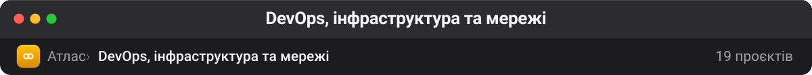

# DevOps, інфраструктура та мережі

Контейнери, Kubernetes, Terraform, мережеві утиліти й самохостинг. Помітно менший блок, ніж AI, і це чесно відображає зміщення фокусу: інфраструктурні форки здебільшого 2021–2024 років, тоді як AI-шар — останнього року.

| Проєкт | Оригінал | ★ | Мова | Що це |
| --- | --- | --: | --- | --- |
| [ripienaar/free-for-dev](https://github.com/ripienaar/free-for-dev) 📋🔗 | — | 143 445 | HTML | A list of SaaS, PaaS and IaaS offerings that have free tiers of interest to devops and infradev |
| [omacom/omarchy](https://github.com/omacom/omarchy) 🔗 | — | 47 438 | Shell | Beautiful, Modern & Opinionated Linux |
| [jdx/mise](https://github.com/jdx/mise) 🔗 | — | 36 428 | Rust | dev tools, env vars, task runner **— заміна asdf/nvm/pyenv одним бінарником — керує і версіями інструментів, і env, і тасками** |
| [milanm/DevOps-Roadmap](https://github.com/milanm/DevOps-Roadmap) 🔗 | — | 21 027 | — | DevOps Roadmap for 2026. with learning resources |
| [sqshq/sampler](https://github.com/sqshq/sampler) 🔗💤 | — | 14 821 | Go | Tool for shell commands execution, visualization and alerting. Configured with a simple YAML file. |
| [awesome-lists/awesome-bash](https://github.com/awesome-lists/awesome-bash) 📋🔗 | — | 10 221 | Shell | A curated list of delightful Bash scripts and resources. |
| [RoutineMiku/apkstart](https://github.com/RoutineMiku/apkstart) 🔗 | — | 9 442 | JavaScript | Windows 上的安卓应用运行器：双击 APK 即装，应用以独立窗口与桌面图标运行，自持 QEMU 运行时 |
| [remote-android/redroid-doc](https://github.com/remote-android/redroid-doc) 🔗 | — | 7 200 | Shell | redroid (Remote-Android) is a multi-arch, GPU enabled, Android in Cloud solution. Track issues / docs here |
| [pshenok/server-survival](https://github.com/pshenok/server-survival) 🔗 | — | 6 515 | JavaScript | Tower defense game that teaches cloud architecture. Build infrastructure, survive traffic, learn scaling. |
| [lissy93/networking-toolbox](https://github.com/lissy93/networking-toolbox) 🔗 | — | 2 733 | Svelte | 🛜 100+ offline-first networking tools and utilities |
| [ccbrown/iocraft](https://github.com/ccbrown/iocraft) 🔗 | — | 1 586 | Rust | A Rust crate for beautiful, artisanally crafted CLIs, TUIs, and text-based IO. **— Rust-крейт для CLI/TUI; без тем/ключових слів правила не бачать** |
| [Manoj-engineer/k8squest](https://github.com/Manoj-engineer/k8squest) 🔗 | — | 1 528 | Shell | K8sQuest — A local, hands-on Kubernetes learning game with real-world troubleshooting challenges. Practice Pods, Deployments, Services, networking, storage, and… |
| [karam-ajaj/atlas](https://github.com/karam-ajaj/atlas) 🔗 | — | 1 348 | JavaScript | Open-source tool for network discovery, visualization, and monitoring. Built with Go, FastAPI, and React, supports Docker host scanning. |
| [zqxwce/vphone-ws](https://github.com/zqxwce/vphone-ws) 🔗 | — | 1 225 | Swift | A native macOS app for managing virtual iPhones - browse, create, and boot iOS research VMs from a single window. **— менеджер віртуальних iPhone на macOS; без тем правила не бачать** |
| [AmineDjeghri/personal-os-setup](https://github.com/AmineDjeghri/personal-os-setup) 🔗 | — | 684 | Python | An app and guide to easily configure Windows, Linux, MacOS, Google TV, Stremio, Home Assistant and more (including WSL2, GPU drivers & development tools). Improve… |
| [hoangsvit/google-ai](https://github.com/hoangsvit/google-ai) 🔗 | — | 422 | Python | A terminal toolkit for Windows and macOS to inspect Google AI Pro offers through Android, ADB, Frida and Google Play. The shared Textual dashboard uses a… **— ADB/Frida toolkit для Google AI Pro offers; gemini у темах тягне в агентів** |
| [daslearning-org/OpenSMS](https://github.com/daslearning-org/OpenSMS) 🔗 | — | 387 | Python | An open-source solution for a SMS API Server hosted locally **— локальний SMS API/gateway на Android; слово gateway тягне в LLM-інфру** |
| [AlariCode/docker-demo](https://github.com/AlariCode/docker-demo) 🔗💤 | — | 43 | TypeScript | — |
| [dimdimuzun/LearningTerraform](https://github.com/dimdimuzun/LearningTerraform) 🔗💤 | — | 0 | HCL | — |

---

**Інші теки** · [Архів](archive.md) · [Безпека](security.md) · [QA](qa.md) · [Skills](skills.md) · [LLM-інфра](llm-infra.md) · [Пам'ять](memory.md) · [Медіа](media.md) · [Агенти](agents.md) · [Ресурси](resources.md) · [Веб](web.md)

[← На робочий стіл](../README.md)
