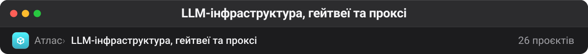

# LLM-інфраструктура, гейтвеї та проксі

Шар під агентами: сервери інференсу, маршрутизатори моделей, проксі для економії токенів і локальні голосові моделі. Це те, що визначає вартість і швидкість усього, що вище. Форки тут — переважно про незалежність від одного провайдера: гейтвеї на 200+ моделей, локальний STT/TTS, обхід rate limit.

| Проєкт | Оригінал | ★ | Мова | Що це |
| --- | --- | --: | --- | --- |
| [vllm-project/vllm](https://github.com/vllm-project/vllm) 🔗 | — | 94 126 | Python | A high-throughput and memory-efficient inference and serving engine for LLMs |
| [rtk-ai/rtk](https://github.com/rtk-ai/rtk) 🔗 | — | 83 941 | Rust | CLI proxy that reduces LLM token consumption by 60-90% on common dev commands. Single Rust binary, zero dependencies |
| [diegosouzapw/OmniRoute](https://github.com/diegosouzapw/OmniRoute) 🔗 | — | 78 327 | TypeScript | Never stop coding. Free MIT AI gateway: one endpoint, 375 providers (150+ free), 1,400+ models Kimi, Claude, GPT, Gemini, GLM, DeepSeek, MiniMax. Works with Claude… |
| [unslothai/unsloth](https://github.com/unslothai/unsloth) 🔗 | — | 78 250 | Python | Local UI to run and train LLMs and diffusion models. Supports GGUF, MLX, Qwen3.8, DeepSeek-V4, MiniMax-H3, Gemma 4, FLUX and more. |
| [headroomlabs-ai/headroom](https://github.com/headroomlabs-ai/headroom) 🔗 | — | 76 001 | Python | Compress tool outputs, logs, files, and RAG chunks before they reach the LLM. 20% fewer tokens for coding agents, 60-95% fewer tokens for JSON, same answers.… |
| [Alishahryar1/free-claude-code](https://github.com/Alishahryar1/free-claude-code) 🔗 | — | 61 764 | Python | Use Claude Code, Codex, VSCode, Pi, and OpenCode (and 6 other harnesses) for free (1.3B+ free tokens) from your terminal, app, IDE, or phone, and now from the… |
| [router-for-me/CLIProxyAPI](https://github.com/router-for-me/CLIProxyAPI) 🔗 | — | 55 672 | Go | Wrap Antigravity, ChatGPT Codex, Claude Code, Grok Build, Muse Code, Devin as an OpenAI/Gemini/Claude/Codex compatible API service, allowing you to enjoy the free… |
| [microsoft/VibeVoice](https://github.com/microsoft/VibeVoice) 🔗 | — | 54 878 | Python | Open-Source Frontier Voice AI |
| [AlexsJones/llmfit](https://github.com/AlexsJones/llmfit) 🔗 | — | 38 117 | Rust | Hundreds of models & providers. One command to find what runs on your hardware. **— підбирає локальні LLM під залізо; тема skill збиває в skill-паки** |
| [tashfeenahmed/freellmapi](https://github.com/tashfeenahmed/freellmapi) 🔗 | — | 37 366 | TypeScript | 7.4 billion tokens per month. 34 free LLM providers. 635 free model endpoints. All behind one /v1 endpoint, plus any custom OpenAI-compatible endpoint. Smart… **— автори прямо пишуть: лише для особистих експериментів — умови провайдерів діють і через проксі** |
| [p-e-w/heretic](https://github.com/p-e-w/heretic) 🔗 | — | 35 846 | Python | Fully automatic censorship removal for language models |
| [NandhaKishorM/laya](https://github.com/NandhaKishorM/laya) 🔗 | — | 33 486 | Python | Non-autoregressive System 1 decision engine. Typed choice, score and yes/no decisions over any text in a single forward pass, in 100+ languages, with a router that… |
| [lbjlaq/Antigravity-Manager](https://github.com/lbjlaq/Antigravity-Manager) 🔗 | — | 32 356 | Rust | Professional Antigravity Account Manager & Switcher. One-click seamless account switching for Antigravity Tools. Built with Tauri v2 + React (Rust).专业的 Antigravity… **— не просто перемикач акаунтів: під капотом проксі-шлюз диспетчеризації запитів до AI-провайдерів** |
| [k2-fsa/OmniVoice](https://github.com/k2-fsa/OmniVoice) 🔗 | — | 14 793 | Python | High-Quality Voice Cloning TTS for 600+ Languages **— українська серед 600+ мов; zero-shot клонування голосу локально, без хмари** |
| [FreeToken](https://github.com/AZANIR/FreeToken) | [FlashML-org/FreeToken](https://github.com/FlashML-org/FreeToken) | 14 591 | Python | FreeToken brings datacenter-scale model serving to your desktop. Run massive models locally, fast and efficiently. |
| [supertone-oss-archive/supertonic](https://github.com/supertone-oss-archive/supertonic) 🔗⚠️ | — | 13 767 | Swift | Lightning-Fast, On-Device, Multilingual TTS — running natively via ONNX. |
| [altic-dev/FluidVoice](https://github.com/altic-dev/FluidVoice) 🔗 | — | 12 291 | Swift | Fastest and only macOS Dictation app with on-device STT and custom trained AI enhancement model. Windows pre-build available! A local Wispr Flow alternative. DM us… |
| [FareedKhan-dev/kimi-k3-in-c](https://github.com/FareedKhan-dev/kimi-k3-in-c) 🔗 | — | 9 107 | C | A 2.78-trillion-parameter Kimi K3 running inference on a single CPU in 8.24 GB of RAM. Portable C99: no BLAS, no framework, no GPU. |
| [superlinked/sie](https://github.com/superlinked/sie) 🔗 | — | 3 414 | Python | Open-source inference server and production cluster for all the models your agent needs. |
| [automazeio/vibeproxy](https://github.com/automazeio/vibeproxy) 🔗 | — | 3 390 | Swift | Native macOS menu bar app to use your Claude Code & ChatGPT subscriptions with AI coding tools - no API keys needed |
| [liaohch3/claude-tap](https://github.com/liaohch3/claude-tap) 🔗 | — | 3 290 | Python | Intercept and inspect Coding Agent API traffic from Claude Code, Codex CLI, Gemini CLI, Cursor CLI, OpenCode, Kimi/Kimi Code, Pi, and Hermes in a local trace viewer. |
| [TheTom/llama-cpp-turboquant](https://github.com/TheTom/llama-cpp-turboquant) 🔗 | — | 2 431 | C++ | LLM inference in C/C++ **— форк llama.cpp з TurboQuant KV-cache** |
| [techjarves/Portable-Local-Studio](https://github.com/techjarves/Portable-Local-Studio) 🔗 | — | 1 544 | JavaScript | Portable local AI studio for Windows, Linux, and macOS. Zero-setup GUI for Image Generation, GGUF LLMs, Text to Speech & Speech to Text |
| [elidickinson/pi-claude-bridge](https://github.com/elidickinson/pi-claude-bridge) 🔗 | — | 670 | JavaScript | Claude Code inference provider for Pi. Allows the use of Claude Code of Pro/Max subscriptions from pi.dev. |
| [smixs/iva-agent](https://github.com/smixs/iva-agent) 🔗 | — | 260 | TypeScript | AI assistant in Telegram that remembers everything and helps you run your life. Self-hosted in one command. |
| [cneuralnetwork/smol-kimi-k3](https://github.com/cneuralnetwork/smol-kimi-k3) 🔗 | — | 98 | Python | A 49M-parameter Kimi K3-inspired language model trainable on one 8GB GPU **— маленька Kimi K3 для тренування на одній 8GB GPU; без тем правила нічого не бачать** |

---

**Інші теки** · [Архів](archive.md) · [Безпека](security.md) · [QA](qa.md) · [Skills](skills.md) · [Пам'ять](memory.md) · [Медіа](media.md) · [Агенти](agents.md) · [DevOps](devops.md) · [Ресурси](resources.md) · [Веб](web.md)

[← На робочий стіл](../README.md)
